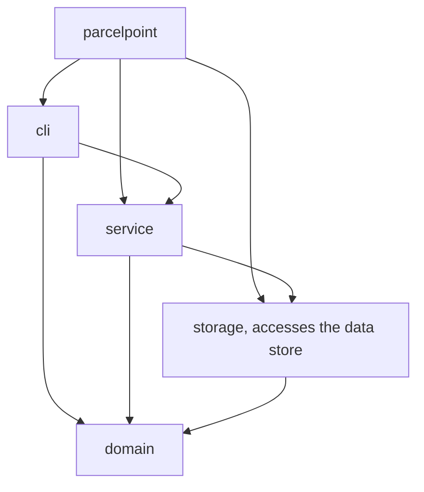
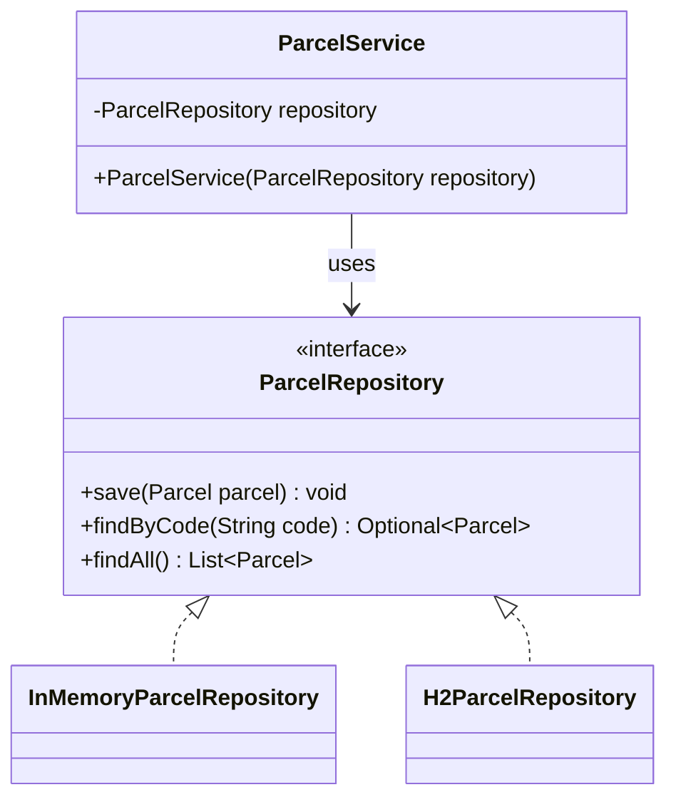
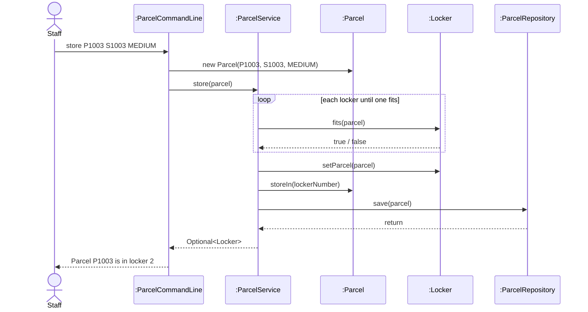

# Lab Report, Designing the Data Management Layer with H2

Repository URL: https://github.com/264135/itcs382-h2-lab

## Tools

| Item | Version or name |
| --- | --- |
| JDK | Eclipse Temurin OpenJDK 25.0.5 (terminal); Maven used Homebrew OpenJDK 27.0.1 |
| Maven | Apache Maven 3.10.0 |
| IDE | Visual Studio Code (macOS; exact version not recorded) |
| AI tool and exact model, if you used one | ChatGPT, GPT-6 |

## Part 0. From a store in memory to H2

Commit of the starter, before any change: No starter commit was made before changing the code. I initialized Git after implementing H2; my first commit was `c6dff3e`.

**0.3 Your prediction for `staff`, written before the second run:**

I did not write down a prediction before the second run. Based on the code, I would expect no parcels and three free lockers because the in-memory data is lost when the program closes.

Output of the second run, for `staff` and `quit`:

```text
> staff
Free lockers: 3
> quit
```

State in one sentence where you think the parcels of the first run were kept.

The parcels were kept in a Java `LinkedHashMap` in RAM, so they disappeared when the program ended.

**0.5 The line of Main that you would change to keep the parcels somewhere else:**

```java
ParcelRepository repository = new InMemoryParcelRepository();
```

**0.6 Commit of the switch to H2:** No separate commit was made. The H2 changes are part of commit `c6dff3e` (`Implement H2 parcel storage and findAll`).

**0.7 Output of `SELECT * FROM PARCEL;` after you stored two parcels:**

I confirmed both records after restarting the program using `find P1001` and `find P1002`. I did not save the H2 Shell output before pickup.

```text
SQL output not recorded before pickup.
```

**0.8 Explain why ParcelPoint could not start while the H2 Shell was open, and identify the class that wrote the message `Cannot create the PARCEL table`.**

When H2 Shell has the database open, ParcelPoint cannot open the same embedded database file from another process in this setup. The `Cannot create the PARCEL table` message is thrown by the `H2ParcelRepository` constructor when connecting to the database fails. I checked this in the code, but did not record the error output.

**0.9 Explain why `staff` shows no parcel while `find` shows each one, and why all three lockers look free.**

At that stage, `findByCode()` was reading from H2, but `findAll()` still returned an empty list. The service uses `findAll()` to load waiting parcels into lockers when it starts. Because it got an empty list, `staff` showed no parcels and all three lockers were counted as free.

**0.11 Your findAll method:**

```java
@Override
public List<Parcel> findAll() {
    List<Parcel> parcels = new ArrayList<>();
    String sql = "SELECT * FROM PARCEL ORDER BY CODE";

    try (Connection connection = connect();
         PreparedStatement statement = connection.prepareStatement(sql);
         ResultSet row = statement.executeQuery()) {

        while (row.next()) {
            parcels.add(toParcel(row));
        }

    } catch (SQLException e) {
        throw new IllegalStateException("Cannot read the parcels", e);
    }

    return parcels;
}
```

Commit that adds findAll: `c6dff3e` (combined H2 and `findAll()` commit).

The rebuilt program showed both parcels after restart and correctly reported `Free lockers: 1`.

**0.12 Output of `SELECT * FROM PARCEL;` after the pickup:**

```text
sql> SELECT * FROM PARCEL;
CODE  | STUDENT_ID | PARCEL_SIZE | STATUS    | LOCKER_NUMBER
P1001 | S1001      | SMALL       | PICKED_UP | null
P1002 | S1002      | LARGE       | STORED    | 3
(2 rows, 32 ms)
```

The program also printed `Parcel P1001 picked up. Fee: 20.0 baht`, and `staff` reported `Free lockers: 2`.

**0.13 Optional:** Not performed.

## Part A. Model the design

**A1 Complete the flowchart with one node for each package and one arrow for each dependency, from the package that uses to the package that is used. Mark the package that accesses the data store.**



State whether cli depends on storage, and explain why.

No. `cli` calls `ParcelService` and uses domain objects, but it does not import any storage classes. The service accesses storage through `ParcelRepository`.

**A2 Complete the class diagram of the data management layer with ParcelService, the interface ParcelRepository with its three operations, and the two classes that implement it.**



**A3 Draw a sequence diagram for the command `store P1003 S1003 MEDIUM`, from the staff member to the repository. Show each message as an operation of the class that receives it.**



Explain why the last lifeline is the interface ParcelRepository rather than H2ParcelRepository.

`ParcelService` only knows the `ParcelRepository` interface. `Main` decides which implementation to use, so the business logic works with either H2 or in-memory storage.

## Part B. Design questions

**1. Identify the files that you changed to move from the store in memory to H2, and explain why no other class had to change. Use the terms of this course.**

I changed `Main.java` to create `H2ParcelRepository` instead of `InMemoryParcelRepository`. I also implemented `findAll()` in `H2ParcelRepository.java`. The service uses the `ParcelRepository` interface, so the rest of the code does not depend on the database implementation. This follows dependency inversion and keeps coupling low.

**2. The PARCEL table stores the size of a parcel as SMALL, MEDIUM or LARGE rather than as 1, 2 or 3. Identify the type of connascence between ParcelSize and the table in each case, and explain which one is weaker.**

With `SMALL`, `MEDIUM`, and `LARGE`, the table and the enum have connascence of name: they must use the same names. With `1`, `2`, and `3`, they would have connascence of convention, because both sides must agree on what each number means. Connascence of name is weaker and easier to understand and maintain.

**3. Project Phase 2 asks for a data store that needs no separate server. Explain why an embedded database such as H2 meets this rule, and describe the limit of an embedded database that Step 0.8 showed.**

H2 runs inside the Java application and stores data in a local file, so we do not need to install or manage a separate database server. A limitation is that two separate processes cannot open the same embedded database file at the same time in the setup used in this lab.

**4. State the data store that you would choose for your Project Phase 2 team, files or an embedded database, the requirement that drives the choice, and the package that will access it.**

I would choose an embedded H2 database because the project requires persistent data without a separate server. It also makes it easier to search and update structured records. The `storage` package would be responsible for reading and writing the data.

## AI usage declaration

| AI tool and exact model | Date | Purpose | Files or answers it produced or changed | How you checked its output |
| --- | --- | --- | --- | --- |
| ChatGPT (GPT-6) | 15 November 2026 | Debugging Java errors, suggesting the `findAll()` method, language editing, and helping draft report answers and Mermaid diagrams. | Suggested code for `H2ParcelRepository.java`; helped draft `LAB_REPORT.md`, including diagrams and explanations. | Compiled with Maven, tested storing and retrieving parcels after restart, checked pickup and the fee, and queried the database using H2 Shell. I also compared the diagrams with the Java code. |
