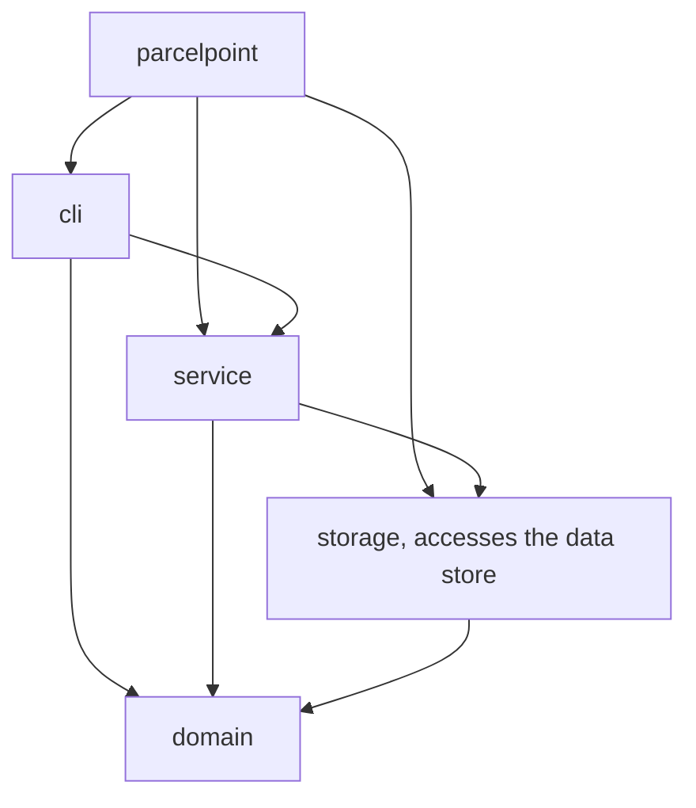
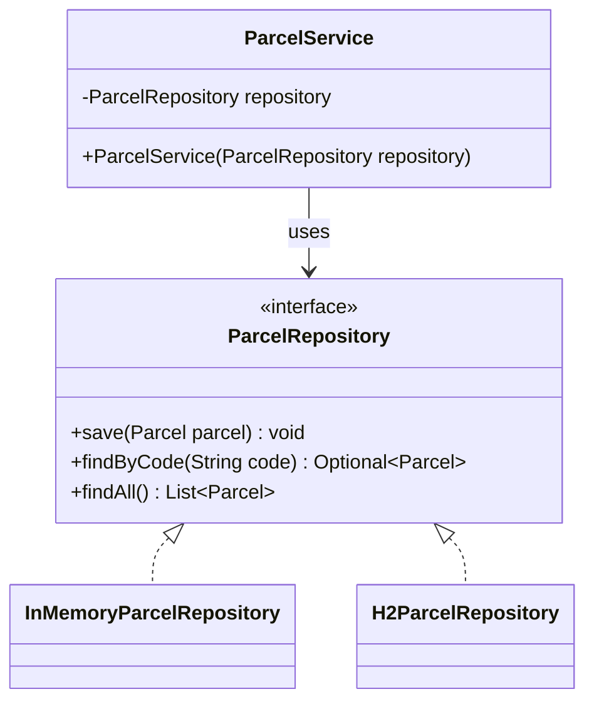
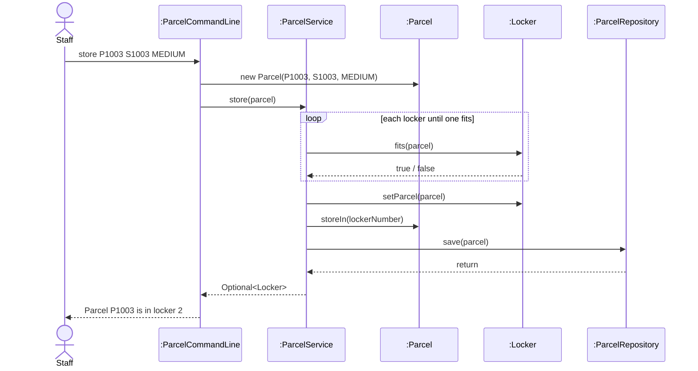

# Lab Report, Designing the Data Management Layer with H2

Repository URL: https://github.com/264135/itcs382-h2-lab

## Tools

| Item | Version or name |
| --- | --- |
| JDK | Eclipse Temurin OpenJDK 25.0.5 (`java -version`); Maven used Homebrew OpenJDK 27.0.1 |
| Maven | Apache Maven 3.10.0 |
| IDE | Visual Studio Code 1.146 (macOS; version confirmed in About Visual Studio Code) |
| AI tool and exact model, if you used one | ChatGPT, GPT-6 |

## Part 0. From a store in memory to H2

Commit of the starter, before any change: I initialized Git after changing the code, so I do not have a separate starter commit. My first commit was `c6dff3e`.

**0.3 Your prediction for `staff`, written before the second run:**

I did not record a prediction before running the program again. The expected behavior is that it shows no parcels and three free lockers because the in-memory data does not survive restarting the program.

Output of the second run, for `staff` and `quit`:

```text
> staff
Free lockers: 3
> quit
```

State in one sentence where you think the parcels of the first run were kept.

They were stored in a Java `LinkedHashMap` in RAM and disappeared when the program ended.

**0.5 The line of Main that you would change to keep the parcels somewhere else:**

```java
ParcelRepository repository = new InMemoryParcelRepository();
```

**0.6 Commit of the switch to H2:** The H2 change and `findAll()` were committed together in `c6dff3e` (`Implement H2 parcel storage and findAll`). There is no separate H2 commit.

**0.7 Output of `SELECT * FROM PARCEL;` after you stored two parcels:**

I ran a fresh verification using a separate H2 database and stored the same two parcels. This is the actual SQL result from that verification, before any pickup:

```text
SQL: SELECT * FROM PARCEL;
CODE  | STUDENT_ID | PARCEL_SIZE | STATUS | LOCKER_NUMBER
P1001 | S1001      | SMALL       | STORED | 1
P1002 | S1002      | LARGE       | STORED | 3
(2 rows, 17 ms)
```

The verification used a separate database and did not modify the original project database.

**0.8 Explain why ParcelPoint could not start while the H2 Shell was open, and identify the class that wrote the message `Cannot create the PARCEL table`.**

I opened the H2 Shell and then tried to start ParcelPoint from a second terminal. ParcelPoint failed because the H2 Shell was already holding a lock on the embedded database file. The error included `Database may be already in use` and `The file is locked`. The message `Cannot create the PARCEL table` came from the constructor of `H2ParcelRepository` (`H2ParcelRepository.java:36`), which wraps the database connection error in an `IllegalStateException`.

**0.9 Explain why `staff` shows no parcel while `find` shows each one, and why all three lockers look free.**

`findByCode()` already read from H2, but `findAll()` still returned an empty list. `ParcelService` uses `findAll()` to put stored parcels back into lockers when the program starts. Because the list was empty, `staff` showed no parcels and counted all three lockers as free.

**0.11 Your findAll method:**

```java
@Override
public List<Parcel> findAll() {
    List<Parcel> parcels = new ArrayList<>();
    String sql = "SELECT * FROM PARCEL ORDER BY CODE";

    try (Connection connection = connect();
         PreparedStatement statement = connection.prepareStatement(sql);
         ResultSet row = statement.executeQuery()) {

        while (row.next()) {
            parcels.add(toParcel(row));
        }

    } catch (SQLException e) {
        throw new IllegalStateException("Cannot read the parcels", e);
    }

    return parcels;
}
```

Commit that adds findAll: `c6dff3e` (same combined commit). After rebuilding, `staff` listed both parcels and reported `Free lockers: 1` after restart.

**0.12 Output of `SELECT * FROM PARCEL;` after the pickup:**

```text
sql> SELECT * FROM PARCEL;
CODE  | STUDENT_ID | PARCEL_SIZE | STATUS    | LOCKER_NUMBER
P1001 | S1001      | SMALL       | PICKED_UP | null
P1002 | S1002      | LARGE       | STORED    | 3
(2 rows, 32 ms)
```

The program printed `Parcel P1001 picked up. Fee: 20.0 baht`. The next `staff` command reported `Free lockers: 2`.

**0.13 Optional:** Not performed.

## Part A. Model the design

**A1 Complete the flowchart with one node for each package and one arrow for each dependency, from the package that uses to the package that is used. Mark the package that accesses the data store.**



State whether cli depends on storage, and explain why.

No. `cli` uses `ParcelService` and domain objects, but does not import classes from `storage`. The service accesses the repository through the `ParcelRepository` interface.

**A2 Complete the class diagram of the data management layer with ParcelService, the interface ParcelRepository with its three operations, and the two classes that implement it.**



**A3 Draw a sequence diagram for the command `store P1003 S1003 MEDIUM`, from the staff member to the repository. Show each message as an operation of the class that receives it.**



Explain why the last lifeline is the interface ParcelRepository rather than H2ParcelRepository.

`ParcelService` uses the `ParcelRepository` interface, not a specific implementation. `Main` chooses which repository to create, so the service can work with H2 or in-memory storage without changing its code.

## Part B. Design questions

**1. Identify the files that you changed to move from the store in memory to H2, and explain why no other class had to change. Use the terms of this course.**

I changed `Main.java` to use `H2ParcelRepository` instead of `InMemoryParcelRepository`, and implemented `findAll()` in `H2ParcelRepository.java`. `ParcelService` depends on the `ParcelRepository` interface, so the business logic did not need to change. This follows dependency inversion and keeps coupling low.

**2. The PARCEL table stores the size of a parcel as SMALL, MEDIUM or LARGE rather than as 1, 2 or 3. Identify the type of connascence between ParcelSize and the table in each case, and explain which one is weaker.**

Using `SMALL`, `MEDIUM`, and `LARGE` gives connascence of name, because the database values must match the enum names. Using `1`, `2`, and `3` would give connascence of convention, because both sides would need to agree on what the numbers mean. Connascence of name is weaker and easier to maintain.

**3. Project Phase 2 asks for a data store that needs no separate server. Explain why an embedded database such as H2 meets this rule, and describe the limit of an embedded database that Step 0.8 showed.**

H2 runs inside the Java application and saves its data in a local file, so a separate database server is not needed. In the embedded setup used here, two different processes cannot access the same database file at the same time.

**4. State the data store that you would choose for your Project Phase 2 team, files or an embedded database, the requirement that drives the choice, and the package that will access it.**

For our Project Phase 2, Team Auslander chose plain-text files for the Gemini Observatory Control System. This meets the requirement for persistent data without a separate server or an extra library, and the files can be created on the first run. The `gemini.persistence` package reads and writes `observations.txt`, `observing-queue.txt`, and `observation-data.txt` through `FileObservationRepository`, `FileObservingQueueRepository`, and `FileObservationDataRepository`. The application services depend on interfaces in `gemini.repository` rather than on file I/O.

## AI usage declaration

| AI tool and exact model | Date | Purpose | Files or answers it produced or changed | How you checked its output |
| --- | --- | --- | --- | --- |
| ChatGPT (GPT-6) | 15 November 2026 | Help with ideas, debugging the Java implementation, suggesting the `findAll()` method, language editing, and drafting report explanations and Mermaid diagrams. | Suggested `findAll()` code used in `H2ParcelRepository.java` and text and diagrams included in `LAB_REPORT.md`. | I built the project with Maven, tested parcel storage and retrieval after restarting the program, checked pickup and its fee, and queried H2 Shell. I reviewed the diagrams against the Java code. |
